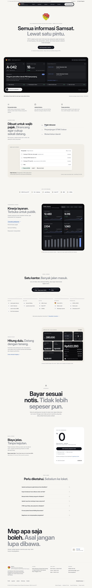
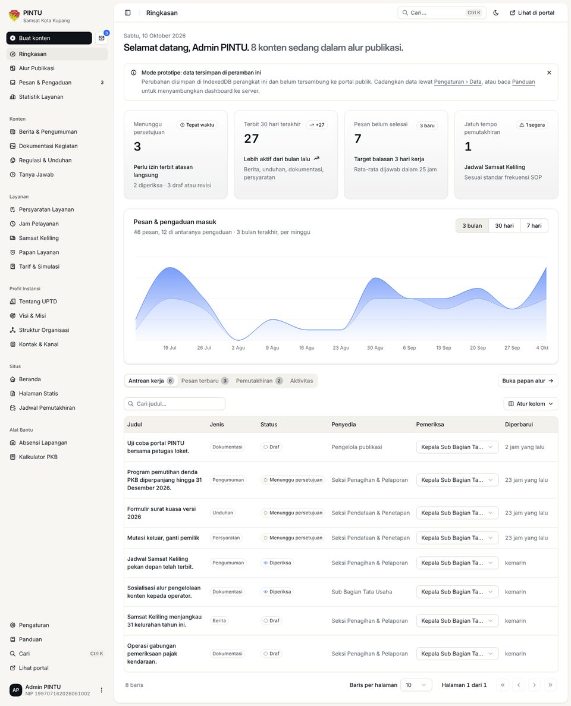

# PINTU — Portal Informasi dan Pelayanan

Portal informasi dan pelayanan **UPTD Pendapatan Daerah Wilayah Kota Kupang (Samsat Kota Kupang)**, Provinsi Nusa Tenggara Timur. Satu aplikasi Laravel 13 berisi halaman publik untuk masyarakat, dashboard pengelolaan konten untuk pegawai (React), dan API JSON.

Disusun dari *Rancangan Aktualisasi* "Penyediaan Website Profil dan Pelayanan Informasi melalui PINTU". Analisa, sitemap, design system, dan tata kelola konten ada di [`docs/RANCANGAN-UIUX.md`](docs/RANCANGAN-UIUX.md). Keputusan teknis ada di [`docs/decisions.md`](docs/decisions.md).

## Pratinjau

| Beranda | Dashboard pengelolaan konten |
|---|---|
|  |  |

Tangkapan layar lain ada di [`docs/preview/`](docs/preview/).

## Struktur

```
app/, bootstrap/, config/, database/, routes/, tests/   aplikasi Laravel (API, model, rute)
resources/views/portal/            16 halaman portal publik (Blade, isi sama dengan HTML asli)
resources/views/portal/partials/   sumber header, footer, dan ikon portal
resources/views/errors/404.blade.php
resources/views/dashboard.blade.php   halaman induk dashboard
resources/js/dashboard/            kode React dashboard
resources/js/portal/               komponen React portal (D-045) dan cek pajak (D-041)
public/assets/                     CSS, JavaScript, dan gambar portal
public/build/                      hasil build Vite untuk dashboard dan portal (tidak di-commit)
docs/                              rancangan, keputusan, API, dashboard, arsip fase
```

| Alamat | Isi |
|---|---|
| `/`, `/profil`, `/layanan`, `/jadwal`, … | Halaman portal. Alamat lama `*.html` dialihkan permanen ke alamat bersih. |
| `/login` | Login pegawai (diperiksa server, lihat di bawah) |
| `/dashboard` | Dashboard pengelolaan konten ([docs/dashboard.md](docs/dashboard.md)) |
| `/api/…` | API JSON ([docs/api.md](docs/api.md)) |

## Kebutuhan

- PHP 8.3+ dengan ekstensi `pdo_mysql`, `mbstring`, `intl`, dan `fileinfo`; Composer 2
- Node.js 20.19+ atau 22.12+
- MySQL 8

## Menyiapkan

```bash
composer install
```

```bash
npm install
```

Salin `.env.example` menjadi `.env` bila belum ada, isi `DB_DATABASE`, `DB_USERNAME`, dan `DB_PASSWORD`, lalu buat struktur database:

```bash
php artisan migrate
```

Jalankan `php artisan key:generate` **hanya** bila `APP_KEY` di `.env` masih kosong; menjalankannya ulang akan membatalkan sesi dan data terenkripsi.

Data kendaraan untuk Kalkulator PKB dan cek biaya pajak di portal ([D-041](docs/decisions.md#d-041--2026-10-14--kalkulator-pkb-dan-cek-biaya-pajak-memakai-mesin-kalkulator-pajak-tarif--simulasi-dipensiunkan)) dibaca dari API data kendaraan (Worker `api-potensi-ntt`) dengan kunci API Data Potensi milik PINTU untuk semua UPT di NTT ([D-076](docs/decisions.md#d-076--2026-10-23--kunci-api-data-potensi-untuk-data-kendaraan-khusus-kota-kupang), [D-077](docs/decisions.md#d-077--2026-10-23--kunci-api-pintu-untuk-semua-upt)): isi `NJKB_API_KEY`, ditambah `NJKB_ACCESS_CLIENT_ID` dan `NJKB_ACCESS_CLIENT_SECRET` (token layanan Cloudflare Access milik PINTU) selama Cloudflare Access masih menjaga hostname API, di `.env`. Jangan memakai kunci atau token aplikasi lain. Tanpa kunci maupun token, pencarian menjawab "Pencarian data kendaraan belum dikonfigurasi." dan kalkulator tetap bisa diisi manual. API BPAD hanya aktif sampai pukul 21.00 WITA; jam layanannya diatur dengan `NJKB_SERVICE_CLOSES_AT` dan `NJKB_SERVICE_OPENS_AT` ([D-042](docs/decisions.md#d-042--2026-10-14--jam-layanan-data-kendaraan-bpad)).

## Menjalankan

Dengan Laravel Herd, situs otomatis tersedia di `http://portal-uptdkotakupang.test`. Herd hanya menyajikan folder `public/`, jadi `.env` dan kode sumber tidak bisa diakses dari peramban. Untuk mengembangkan dashboard dengan muat ulang otomatis:

```bash
npm run dev
```

Tanpa Herd, `composer dev` menjalankan `php artisan serve` dan Vite sekaligus; buka `http://127.0.0.1:8000`.

### Login pegawai

Login diperiksa server dengan sesi cookie Laravel Sanctum ([D-007](docs/decisions.md#d-007--2026-10-13--login-pegawai-dengan-laravel-sanctum)). Untuk pengembangan lokal, buat akun admin lokal (NIP dan kata sandinya ada di `database/seeders/LocalAccountSeeder.php`; seeder ini menolak berjalan di luar lingkungan `local`):

```bash
php artisan db:seed
```

Akun pegawai, termasuk Administrator lain, dibuat Administrator dari halaman *Akun Pegawai* di dashboard ([D-008](docs/decisions.md#d-008--2026-10-13--manajemen-akun-oleh-administrator)). Di sana juga tersedia penugasan modul untuk Pegawai UPTD ([D-010](docs/decisions.md#d-010--2026-10-13--penugasan-modul-untuk-pegawai-uptd)), penangguhan, penonaktifan, dan atur ulang kata sandi lewat tautan aktivasi.

Administrator pertama di produksi dibuat dengan perintah berikut. Di terminal, kata sandi diminta tanpa ditampilkan dan akun langsung aktif.

```bash
php artisan pintu:create-admin 199001012020121001 "Nama Lengkap"
```

Tanpa mode interaktif (`--no-interaction`, misalnya di tab *Commands* Laravel Cloud), tidak ada kata sandi yang ditampilkan. Akun dibuat menunggu aktivasi dan perintah mencetak tautan aktivasi yang berlaku 60 menit dan hanya sekali pakai. Pemilik akun membuka tautan itu dan memilih kata sandinya sendiri: minimal 12 karakter, berisi huruf dan angka. Bila tautan kedaluwarsa, buat tautan baru; tautan sebelumnya otomatis tidak berlaku:

```bash
php artisan pintu:activation-link 199001012020121001
```

Bila Administrator satu-satunya lupa kata sandi, tidak ada Administrator lain yang bisa mengatur ulang akunnya dari dashboard. Atur ulang dari server; kata sandi lamanya langsung tidak berlaku dan perintah mencetak tautan aktivasi baru:

```bash
php artisan pintu:activation-link 199001012020121001 --reset
```

## Pengujian

```bash
composer test
```

Tes berjalan di SQLite di memori. Untuk menjalankan tes yang sama di MySQL, isi `DB_TEST_DATABASE` di `.env` dengan database lokal yang **boleh direset** (setelahnya jalankan lagi `php artisan db:seed` bila database itu juga dipakai untuk login lokal), lalu:

```bash
composer test:mysql
```

Pemeriksaan dashboard:

```bash
npm run typecheck && npm run lint && npm run build
```

## Deploy ke Laravel Cloud

Sejak 2026-10-18 PINTU berjalan di Laravel Cloud dengan domain utama **https://uptdpenda-kupang.web.id** ([D-066](docs/decisions.md#d-066--2026-10-18--domain-utama-uptdpenda-kupangwebid)), dipindahkan **beserta seluruh data database lokal** ([D-065](docs/decisions.md#d-065--2026-10-18--database-produksi-dan-pemindahan-data-ke-laravel-cloud)). Semua langkah di bawah dijalankan pemilik; kredensial Laravel Cloud tidak pernah disimpan di repository atau berkas.

**1. Siapkan di Laravel Cloud** (aplikasi, database, dan bucket di region yang sama: **Asia Pacific (Singapore)**, `ap-southeast-1`):

- **Aplikasi:** dari repository ini. Wizard Laravel Cloud mengenali jenis aplikasi dari *default branch* GitHub, sehingga selama `main` masih situs statis, aplikasinya terdeteksi sebagai HTML. Karena itu default branch GitHub sempat dijadikan `laravel-development` saat aplikasi dibuat. Sejak merge (2026-10-18), default branch dan branch environment adalah `main` ([D-067](docs/decisions.md#d-067--2026-10-18--main-sebagai-branch-produksi-dan-alur-rilis)).
- **Root directory:** root repository.
- **Build command:** bawaan Laravel Cloud (`composer install --no-dev …`, `npm ci --audit false`, `npm run build`) ditambah baris `php artisan optimize`. PHP 8.4, Node 24.
- **Deploy command:** `php artisan migrate --force`
- **Database:** Laravel MySQL ukuran *Flex* (bisa *scale-to-zero*), storage 5 GB, backup harian 7 hari. Kredensialnya disuntikkan otomatis.
- **Bucket (D-028):** dua bucket Object Storage berlokasi Asia-Pacific: bucket privat sebagai disk bawaan (Laravel Cloud menamainya `private`) dan bucket publik dengan nama disk `public`.
- **Variabel lingkungan:**
  - `APP_KEY` sama persis dengan `APP_KEY` di `.env` lokal (pemilik, D-065). KTP dan telepon Pemetaan PKB terenkripsi dengan kunci itu, dan sidik transaksi Laporan Penerimaan memakainya, jadi kunci ini tidak boleh diganti setelah data diimpor.
  - `APP_URL` dengan alamat https produksi.
  - `SESSION_DRIVER=database` (filesystem Cloud tidak permanen), `SESSION_SECURE_COOKIE=true`, `SESSION_LIFETIME=480`, dan `SESSION_EXPIRE_ON_CLOSE=true`.
  - `CACHE_STORE=database`, karena percobaan login dihitung di cache dan semua server harus memakai cache yang sama.
  - `NJKB_API_KEY` (kunci "PINTU" untuk semua UPT dari https://potensi.uptdpenda-kupang.web.id/#kunci, D-076, D-077), `NJKB_ACCESS_CLIENT_ID`, dan `NJKB_ACCESS_CLIENT_SECRET` untuk data kendaraan, serta `NJKB_API_BASE_URL` dan `NJKB_API_TIMEOUT_SECONDS` seperti `.env` lokal.
  - `APP_DEBUG=false` dan `QUEUE_CONNECTION=sync`. PINTU tidak punya pekerjaan antrean, jadi saran Laravel Cloud `QUEUE_CONNECTION=database` tidak dipakai.
- **Push to deploy:** menyala untuk branch `main`. Pekerjaan dilakukan di `laravel-development`, dan setiap "Commit dan Push" juga memajukan `main` ke commit yang sama (*fast-forward*), sehingga langsung tayang ([D-069](docs/decisions.md#d-069--2026-10-19--commit-dan-push-langsung-tayang)). Cloudflare tidak men-deploy apa pun; ia hanya DNS dan pengalihan.
- **Edge network:** aktifkan rate limiting (paket Growth atau Business). Di Cloud, Laravel memercayai semua proxy sehingga IP pengunjung untuk pembatasan laju di aplikasi bisa dipalsukan. Batas percobaan login per NIP tetap berlaku karena tidak bergantung pada IP.

**2. Pindahkan data** dari salinan lokal, sebelum deploy pertama:

1. Ekspor database ke berkas di luar folder proyek:
   `php artisan pintu:export-production D:\pintu-produksi.sql --nip=<NIP Administrator> --nama="<Nama Administrator>"`.
   Berkas berisi seluruh tabel dan tabel `migrations`. Akun admin lokal dari `LocalAccountSeeder`, yang kata sandinya ada di repository, menjadi akun Administrator dengan NIP dan nama itu, berkata sandi acak dan menunggu aktivasi. Sesi, cache, dan token atur ulang dikosongkan. Berkas ini berisi data pribadi wajib pajak: simpan di tempat aman dan hapus setelah diimpor.
2. Di Laravel Cloud, nyalakan *public endpoint* database dan buka *View credentials*. Lalu impor dari PowerShell atau Git Bash; kata sandi diketik saat diminta:
   `mysql --host=<host> --port=<port> --user=<user> --password --ssl-mode=REQUIRED --compress --default-character-set=utf8mb4 <database> -e "source D:/pintu-produksi.sql"` (nama database di Laravel Cloud: `production`).
   Bila impor terputus karena memori, naikkan ukuran database sementara, lalu ulangi; berkas dimulai dengan `DROP TABLE IF EXISTS`. Matikan lagi public endpoint, lalu hapus berkas ekspor.
3. Salin berkas unggahan (`storage/app/public`) ke bucket publik dengan `php artisan pintu:copy-uploads --bucket=<nama bucket publik> --endpoint=<endpoint>`. Access key dan secret dari *View credentials* bucket diketik saat diminta. Berkas privat, bila ada, disalin ke bucket privat dengan `--privat`. Perintah ini boleh diulang; berkas yang sudah ada dilewati.

**3. Deploy dan selesaikan** di tab *Commands*. Kotak perintahnya sudah berisi `php artisan `, jadi ketik lanjutannya saja (mis. `pintu:activation-link <NIP>`):

1. Deploy. `migrate --force` tidak menemukan migrasi baru karena tabel `migrations` ikut diimpor.
2. `php artisan pintu:rewrite-upload-urls http://portal-uptdkotakupang.test --dry-run`, lalu ulangi tanpa `--dry-run`. Konten menyimpan alamat lengkap unggahan (`http://portal-uptdkotakupang.test/storage/…`), dan perintah ini menggantinya dengan alamat bucket. Pada data 18 Oktober 2026 ada 10 baris.
3. `php artisan pintu:activation-link <NIP Administrator>`, lalu buka tautan yang dicetak untuk membuat kata sandi. Tautan berlaku 60 menit.
4. Periksa portal dan dashboard, lalu nyalakan *Scheduler* (pembersihan unggahan harian, `model:prune`).
5. Pasang domain di *Settings › Network › Add domain*: pilih *Redirect from www*, tanpa wildcard, *Domain is managed by Cloudflare* (tanpa proxy), dan *Ensure uninterrupted domain transfer*. Tambahkan record TXT dan `_acme-challenge` yang diminta (DNS only), klik *Pre-verify*, lalu tambahkan CNAME `@` dan `www` ke `to.laravel.cloud` (DNS only) dan klik *Verify records*. Setelah *Connected*, pilih *Set as primary* (menjadi `APP_URL`) lalu deploy ulang. Alamat lama `pintu.uptdpenda-kupang.web.id` dialihkan dengan Cloudflare Redirect Rule, dan deploy otomatis Cloudflare Pages dimatikan (D-066).

Tanpa data lokal (database kosong), Administrator pertama dibuat di tab *Commands* dengan `php artisan pintu:create-admin <nip> "<nama>" --no-interaction`; kirim tautan aktivasi yang dicetak hanya kepada pemilik akun. Bila tautan terlewat, jalankan `php artisan pintu:activation-link <nip>`.

## Mengubah header, footer, atau ikon portal

Sumbernya ada di `resources/views/portal/partials/`. Periksa dulu halaman mana yang akan berubah, lalu salin ke semua halaman. Skrip mempertahankan akhir baris setiap halaman, hanya menyebut halaman yang isinya berbeda, dan berhenti dengan galat bila penanda `<!-- @header -->`/`<!-- /@header -->` (atau `@footer`, `@icons`) tidak berpasangan:

```bash
node scripts/sync-partials.mjs --check
```

```bash
node scripts/sync-partials.mjs
```

## Konten dinamis

Jam loket dan rotasi Samsat Keliling ada di objek `CONFIG` pada `public/assets/js/main.js`. Semua konten ini juga sudah dimodelkan di dashboard; langkah berikutnya adalah membaca isi portal dari database lewat Laravel. Nilai yang ditandai titik kuning di halaman adalah **data contoh** dan wajib diverifikasi petugas sebelum terbit.

## Logo

Logo utama adalah **Lambang Provinsi Nusa Tenggara Timur** (`public/assets/img/lambang-ntt.png` dan turunan `lambang-ntt-*.webp`). Aturan pemakaian ada di seksi *Logo & lambang* pada halaman `/design-system`.

Logo PINTU (pintu terbuka) **disimpan sebagai logo cadangan** dan tidak tampil saat ini: simbol `#logo-pintu` di `resources/views/portal/partials/icons.html`, berkas `public/assets/img/logo-pintu.svg` dan `public/assets/img/favicon.svg`.

## Tipografi

Situs memakai **SF Pro Display** (headline dan angka besar) dan **SF Pro Text** (isi dan UI) sebagai font sistem. Berkas font tidak disertakan karena lisensi Apple tidak mengizinkan distribusi lewat web. Perangkat Apple menampilkan SF Pro, sedangkan perangkat lain memakai font sistemnya (Segoe UI di Windows, Roboto di Android). Token ada di `public/assets/css/tokens.css` (`--font-display`, `--font-sans`).

## Dokumen lain

- [`KONTEKS-PROYEK.md`](KONTEKS-PROYEK.md): konteks lengkap dan status terakhir proyek dalam satu berkas, untuk agen AI dan pengembang berikutnya. Diperbarui setiap ada perubahan.
- [`docs/phases/`](docs/phases/): rekam jejak keamanan, tata kelola, dan rancangan API (Phase 1.1–2.19). Rekomendasi di dalamnya belum tentu disetujui; keputusan yang berlaku ada di `docs/decisions.md`.
- [`HANDOVER-CHATGPT.md`](HANDOVER-CHATGPT.md): audit 11 Oktober 2026, sebelum struktur satu aplikasi Laravel.

## Lisensi aset

Lambang Provinsi NTT adalah milik Pemerintah Provinsi NTT dan dipakai sesuai ketentuan lambang daerah.
