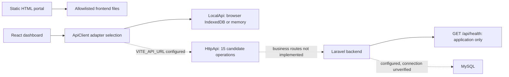
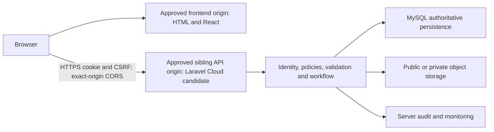
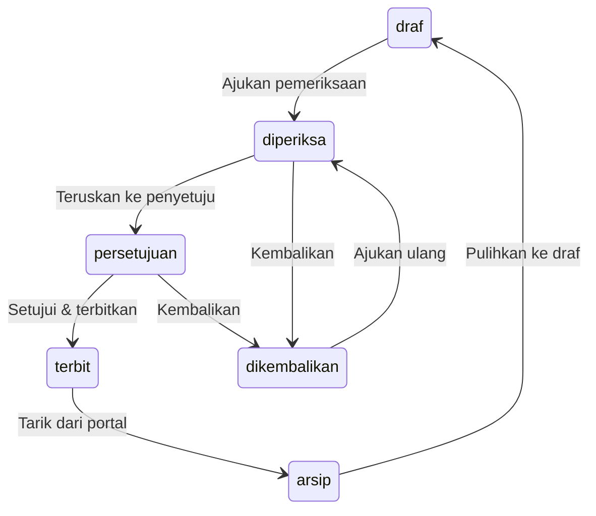

# PINTU — Phase 2: Architecture and API Design

**Date:** 2026-10-12. **Status: DESIGN PROPOSAL — IDENTITY SOURCE CONFIRMED BY USER; REMAINING APPROVALS OPEN; NOT IMPLEMENTED.**

Applies to Portal Informasi dan Pelayanan, UPTD Pendapatan Daerah Wilayah Kota Kupang / Samsat Kota Kupang, BPAD Provinsi Nusa Tenggara Timur. This document extends [Phase 1.1 discovery](PHASE-1.1-SECURITY-AND-INTEGRATION-DISCOVERY.md); it does not replace that report or change Indonesian UI terminology. Originally added during Phase 2, it is now updated to record the user's identity decision and link the [bounded Phase 3 scope](PHASE-3-IDENTITY-AND-PERSISTENCE-FOUNDATION-SCOPE.md). Neither document authorizes implementation.

## 1. Executive summary and decision vocabulary

The static public portal and React dashboard already contain useful contracts, but they are not a production CMS, authenticated service, official attendance system, or authoritative tax engine. Laravel 13.35.0 implements an application-only health API. Browser records, example seeds, role labels, dates and history are untrusted migration inputs, not server facts.

**Confirmed user decision (2026-10-12):** identity will use local PINTU application accounts managed by authorized administrators, with no public self-registration by default. The identities of authorized administrators and the administrative approval process have not been specified. **MFA is undecided and requires explicit security approval**; it is not approved, mandatory, optional, rejected, or implicitly omitted. Sanctum cookie/session authentication remains the recommended first-party SPA mechanism, conditional on domain/origin/CSRF/cookie/session decisions, not an implemented feature.

Recommended direction, subject to approval:

1. Keep the HTML portal and existing React/Vite dashboard; preserve their public-file serving boundary. Host frontend output independently and expose Laravel on a dedicated API subdomain under the same owner-controlled parent domain.
2. Use first-party Laravel cookie/session SPA authentication, with Sanctum as the candidate integration package, if the common-domain and trusted-subdomain prerequisites are approved. Do not use long-lived browser personal-access tokens merely to avoid adapting the prototype client.
3. Use Laravel policies and explicit per-operation/object permissions, server-owned workflow history and identity, reviewed content revisions, and MySQL transactions. Existing labels do not define official approvers.
4. Model business aggregates and typed configuration documents, not automatically 12 collection tables plus 10 singleton tables. Separate identity from `akun` settings and private operations from public representations.
5. Preserve the client-facing Indonesian field names where safe. Adopt its existing routes as candidate contracts, with explicit changes for pagination, concurrency, workflow, identity and risky bulk operations before integration.
6. Migrate only owner-reviewed records through a dry-run, provenance and conflict-resolution process. Do not import seeds or local audit histories as official records.

| Label | Meaning in this document |
|---|---|
| **Verified** | Current repository source or cited authoritative documentation supports the statement; no remote PINTU deployment or database verification is implied |
| **Confirmed user decision** | Explicit user approval of the named decision only; it does not approve associated policies, dependencies or implementation |
| **Recommended** | Proposed engineering choice with rationale, alternatives and risks; not implementation or business approval |
| **Requires approval** | Named owner must resolve the product/security/operational decision before affected implementation |
| **Blocked** | Evidence, credentials, access or an approved dependency is missing |
| **Deferred safely** | Outside the bounded identity foundation; deferral is safe only while the affected business capability remains disabled/excluded |

Recommendations may also require approval. The decision register in Section 11 is the approval ledger; only the explicit local-account identity source is confirmed by the current user instruction. No other entry is approved by generating this document.

## 2. Preflight and verified current architecture

### 2.1 Working tree

`git branch --show-current` returned `laravel-development`. No files were staged. Pre-existing modified files: `.gitignore`, `README.md`, `dashboard-app/README.md`, `dashboard-app/vite.config.ts`, `docs/RANCANGAN-UIUX.md`, `index.html`. Pre-existing untracked paths: `HANDOVER-CHATGPT.md`, `backend/`, `scripts/frontend-public.d.mts`, `scripts/frontend-public.mjs`, `scripts/independent-security-test.mjs`, `scripts/serve-frontend.mjs`, `scripts/stage-frontend.mjs`, `scripts/tests/`.

The `index.html` diff was already 1,996 additions / 672 deletions. The complete tracked working-tree binary diff fingerprint was `cac31712e8536b629d9fec47bb290ddea1f9c29e`. A Git file-inventory content fingerprint in command output order, using `git ls-files --cached --others --exclude-standard | git hash-object --stdin-paths | git hash-object --stdin`, was `0fda4a55c7500a5fad6ce26fb6c15d1e72b20f10` before adding this document. These are preservation evidence, not commits.

Important baseline blobs: `index.html` = `3cbcc556754ad30593470587aa3282a7ff846b9e`; `HANDOVER-CHATGPT.md` = `e84e2271948fe07a22c3c21c5f1d76fba06726b8`; dashboard manifest = `308df7d3574858be219f1f9ea1cbcbd7673c74bf`; dashboard lockfile = `0dab9cb421b0da68c6ad03d6e9fdd1c36416888e`.

The preceding paragraphs record the original Phase 2 preflight. Git does not record when untracked files changed, so an exhaustive historical claim about every intervening edit is unavailable. For this decision update, branch remains `laravel-development`; the same six tracked changes remain and nothing is staged. Additional pre-existing tooling paths now include `.agents/`, `.vscode/`, `AGENTS.md`, `kilo.json`, `skills-lock.json` and Boost artifacts within `backend/`. They are preserved, not installed or changed by this task. Original tracked-diff fingerprint remains `cac31712e8536b629d9fec47bb290ddea1f9c29e`; current pre-existing file-inventory fingerprint excluding this document is `43fbbc778c65d103f9bc6ac800d42c2e78f75571`. The new Phase 3 document must also be excluded from the final inventory comparison. Phase 1.1 report and all runtime files remain untouched.

### 2.2 Source evidence register

All paths below are repository-relative; cited source definitions take precedence over historical summaries and examples.

| ID | Source | Verified evidence |
|---|---|---|
| S1 | `dashboard-app/src/lib/api/client.ts:24-49` | Exactly 15 `ApiClient` methods |
| S2 | `dashboard-app/src/lib/api/http.ts:22-130` | REST verbs/paths, bare JSON results, optional bearer header, 204 handling, 404-to-null, `message`/`pesan` error parsing |
| S3 | `dashboard-app/src/lib/api/index.ts:9-12` | Trimmed non-empty `VITE_API_URL` selects `HttpApi`; otherwise `LocalApi` |
| S4 | `dashboard-app/src/lib/api/types.ts:11-300,308-473` | 12 `Koleksi` members; 10 `Pengaturan` members; scalar, nested, workflow, activity and snapshot definitions |
| S5 | `dashboard-app/src/lib/api/local.ts:74-340` | IndexedDB, memory fallback, serialized writes, ID/time generation, logs, uploads, export/import/reset |
| S6 | `dashboard-app/src/lib/api/seed.ts`, `dashboard-app/src/lib/id.ts` | Prototype initial data; browser-generated 16-character hex IDs, not UUIDs |
| S7 | `dashboard-app/src/lib/auth.ts:14-55`, `assets/js/main.js` | `pintu.sesi` JSON and client expiry checks; static prototype login, not server authentication |
| S8 | `dashboard-app/src/lib/alur.ts:7-31`, `dashboard-app/src/lib/meta.ts:96-172`, `dashboard-app/src/components/alur/alur.tsx` | Client transition graph, revision note and publish action; generic PATCH with client history/actor |
| S9 | `dashboard-app/src/lib/validasi.ts:3-48`, `dashboard-app/src/lib/queries.ts` | Form helper constraints, cache/retry behavior; no server validation |
| S10 | `backend/routes/api.php:6-10`, `backend/bootstrap/app.php:8-22`, `backend/routes/web.php`, `backend/routes/console.php` | Only business-facing API is `GET /api/health`; framework `/up` and welcome web route are separate; API JSON errors configured |
| S11 | `backend/config/database.php:20,47-65`, `backend/config/session.php`, `backend/config/filesystems.php`, `backend/.env.example`, `backend/phpunit.xml:20-34` | Environment-based MySQL configuration, local file/sync drivers; existing test config uses SQLite `:memory:` |
| S12 | `backend/tests/Feature/HealthCheckTest.php`, `backend/tests/Feature/ExampleTest.php`, `backend/tests/Unit/ExampleTest.php`, `backend/composer.lock`, `backend/README.md` | Foundation tests and locked framework; no CRUD/auth/domain tests or implementations |
| S13 | `dashboard-app/vite.config.ts`, `scripts/frontend-public.mjs`, `scripts/serve-frontend.mjs`, `scripts/stage-frontend.mjs`, `scripts/tests/frontend-security.test.mjs`, `scripts/independent-security-test.mjs` | Restricted public/frontend serving and packaging; existing local security tests |
| S14 | `HANDOVER-CHATGPT.md:924-949`, `dashboard-app/package.json` | Historical Pages output `_site`; actual current remote settings unverified; frontend build scripts do not constitute deployment |
| S15 | `dashboard-app/src/pages/berita/editor.tsx`, `dashboard-app/src/pages/layanan/editor.tsx`, `dashboard-app/src/pages/dokumentasi.tsx`, `dashboard-app/src/pages/unduhan.tsx`, `dashboard-app/src/pages/halaman/editor.tsx`, `dashboard-app/src/pages/faq.tsx`, `dashboard-app/src/pages/jadwal/keliling.tsx`, `dashboard-app/src/pages/jadwal/jam.tsx`, `dashboard-app/src/pages/struktur.tsx`, `dashboard-app/src/pages/pesan.tsx`, `dashboard-app/src/pages/pemutakhiran.tsx` | Per-module form validation, not server rules |
| S16 | `dashboard-app/src/pages/beranda.tsx`, `dashboard-app/src/pages/profil.tsx`, `dashboard-app/src/pages/visi-misi.tsx`, `dashboard-app/src/pages/kontak.tsx`, `dashboard-app/src/pages/papan.tsx`, `dashboard-app/src/pages/statistik.tsx`, `dashboard-app/src/pages/pengaturan.tsx`, `dashboard-app/src/pages/tarif.tsx` | Setting validation and destructive-operation UI |
| S17 | `dashboard-app/src/pages/absensi.tsx`, `dashboard-app/src/lib/gambar.ts`, `dashboard-app/src/components/form/media-fields.tsx`, `dashboard-app/src/components/form/photo-field.tsx` | Attendance capture, nullable GPS, client media compression/pickers |
| S18 | `dashboard-app/src/lib/pajak.ts`, `dashboard-app/src/pages/kalkulator.tsx`, `dashboard-app/src/components/form/settings-form.tsx`, `dashboard-app/src/components/form/entri-sheet.tsx`, `dashboard-app/src/components/form/rich-text-field.tsx`, `dashboard-app/src/components/form/rich-text-editor.tsx` | Prototype calculator, form persistence and editor behavior |

**Verified counts:** 15 methods = list, get, create, update, remove, reorder, getSetting, saveSetting, settingsUpdatedAt, activity, clearActivity, upload, exportAll, importAll, reset. Collections = berita, dokumentasi, dokumen, layanan, faq, keliling, penyesuaian, unit, pesan, halaman, pemutakhiran, absensi. Settings = situs, beranda, papan, jam, tarif, statistik, profil, visiMisi, kontak, akun.

No domain migrations or models were added in earlier phases. Standard `User`, users/cache/jobs migrations and a factory are framework scaffolding, not an approved identity/domain schema and not evidence of actual database tables. Database existence remains unverified. Source tests cover the foundation and serving security; no frontend API adapter or complete business integration suite was found.

No Sanctum/authentication package, stateful API middleware or custom CORS policy is implemented. Phase 1.1 observed the unchanged Laravel API default `Access-Control-Allow-Origin: *`; that default is not a credentialed-cookie integration policy and does not authenticate or authorize requests. Current local `file` sessions/cache and synchronous queue are foundation defaults, not approved Cloud production configuration.

## 3. Application and deployment topology

### 3.1 Evidence and capability boundaries

Authoritative documentation consulted on 2026-10-12:

- [Laravel 13 Sanctum](https://laravel.com/docs/13.x/sanctum): first-party SPA cookie authentication; SPA/API must share the same top-level domain; credential/CSRF transport configuration; tokens are an alternative for non-first-party clients. A token ability check does not replace a policy.
- [Laravel Cloud domains](https://cloud.laravel.com/docs/domains): documented assigned/custom domains and TLS/DNS verification mechanisms.
- [Laravel Cloud environments](https://cloud.laravel.com/docs/environments): documented environment variables; per-replica ephemeral filesystem; persistent session/cache and object-storage requirements.
- [Laravel Cloud deployments](https://cloud.laravel.com/docs/deployments): documented build/deploy steps and default push-to-deploy behavior.
- [Cloudflare Pages build configuration](https://developers.cloudflare.com/pages/configuration/build-configuration/): output directory controls published artifacts; Phase 1.1 consulted this reference, not the PINTU account.

Documentation proves platform conventions, **not** PINTU account access, subscription, configured domains, runtime/region approval, DNS authority, monorepo root handling, network reachability, resource provisioning, backup guarantees or successful deployment. A guessed Cloud domains URL failed before the canonical reference was located; it supplied no evidence. No external infrastructure was modified or probed.

### 3.2 Options

| Option | Origin, CORS and authentication | Environment and files | Local parity, complexity and risks |
|---|---|---|---|
| T1: independently hosted frontend and Laravel on unrelated provider domains | Different origins **and sites**; explicit CORS. Cross-site cookies encounter SameSite/browser third-party restrictions and do not satisfy Sanctum's standard first-party SPA prerequisite. Bearer or an approved gateway/identity architecture would need separate evaluation. | Frontend API base is public build configuration. Backend secrets only on server. Upload/download hosts need independent CORS and private-file controls. | Two deploy pipelines, preview-origin policy, cookie reliability risks; low packaging coupling but poor recommended cookie-auth parity. Suitable for static preview, not an assumed production protected topology. |
| T2: independent frontend host plus API sibling subdomain under one controlled parent | Different origins, normally same site when scheme aligns. Explicit exact-origin credentialed CORS still required; sharing a parent does **not** remove CORS. First-party cookie/CSRF architecture becomes viable. | Separate frontend/API build variables; review cookie domain/stateful domains. Public and private object access remain separate. | Preserves current static/React packaging, no reverse proxy required. Needs approved parent-domain control, trusted siblings, DNS/TLS, host policy and two release pipelines. Local ports on one consistent hostname model cross-origin behavior; staging must test real HTTPS siblings. |
| T3: same-origin gateway serving static files and proxying API to Laravel | Browser requests share origin; browser CORS unnecessary for API, but cookie CSRF remains. Gateway must route authentication/CSRF and files consistently, not only `/api/*`. | Public-only frontend artifact; backend `/public` behind gateway; proxy headers, cookie paths, request/body limits, cache bypass and timeout configuration. | Added gateway ownership and failure modes, previews and forwarded-host trust. No current proxy exists; provider capabilities/account settings need validation. |
| T4: package frontend artifact with Laravel under one origin | Same-origin cookie auth; no cross-origin API CORS. Existing HTML/React can remain static assets rather than a React portal rewrite. | Would need a future approved build artifact layout inside a public-only tree, exclusion of internals and collision/routing checks; persistent uploads cannot live on Cloud ephemeral disk. | Coupled releases/build changes and monorepo packaging verification; greater repository/build work than T2. Cloud support for this exact PINTU layout is not verified. |

**Recommended: T2**, contingent on infrastructure and security-owner approval. It preserves the current frontend without a gateway, supports Laravel first-party SPA sessions, and minimizes migration changes. **Alternatives:** T3 if approved infrastructure already supplies a managed gateway; T4 if a single-release operational model outweighs packaging changes. T1 is not a reason to silently adopt browser personal-access tokens. If no shared controlled domain is available, recommendation is **Blocked** pending reevaluation, not an approved fallback.

All siblings sharing cookies must be trusted; legacy/static rich-text XSS can attack the session even if it cannot read an HttpOnly cookie. Minimize cookie scope while satisfying the selected CSRF/domain strategy; broad parent-domain cookies are not automatic permission to trust every subdomain. Exact hostnames, preview exposure and separate employee/public hosting are owner decisions.

### 3.3 Future configuration and operational gates

Recommended deployment checklist, **not applied**: API `APP_URL`/trusted hosts/proxies; `APP_DEBUG=false`; approved DB connection/TLS; persistent shared session/cache store; stable `APP_KEY`; stateful frontend domains including local ports; exact CORS origins/methods/headers/credential policy; Secure/HttpOnly/SameSite cookie choices; object-storage disk and access credentials; public frontend `VITE_API_URL`; separate test/staging resources. Do not put secrets in `VITE_*` values or public output.

Cloud documentation's ephemeral filesystem makes current `SESSION_DRIVER=file` and `CACHE_STORE=file` local conveniences, not production recommendations. Prefer database-backed sessions initially if approved load/availability warrants it; shared Redis-compatible storage is an alternative with additional infrastructure. Decide TTLs, logout-all and failover with the security/operations owner; do not copy prototype eight-hour/seven-day expiry as official policy.

Local testing must use one hostname consistently rather than mixing `localhost` and `127.0.0.1`. Use explicit ports for stateful-domain and CORS tests; test CSRF, logout, expiry, cross-origin uploads and HTTPS siblings before release. Preserve Phase 1.1 allowlisted servers; never serve the repository or `backend/` root. Future deployment root must target `backend/` and HTTP entry point `backend/public`, but actual Cloud monorepo configuration is **Requires approval / unverified**. Separate frontend packaging must publish only safe staging output. No frontend build or deployment runs in this phase.

Public download representations may use stable CDN URLs only for approved public files. Private messages/attendance files require authenticated streaming or short-lived authorized download URLs; signing and expiry are owner-approved parameters. CORS on object storage is a separate concern from API CORS, and an unguessable public URL is not authorization.

## 4. Authentication, authorization and workflow

### 4.1 Authentication decision matrix

| Approach | Credential behavior and CSRF | Lifecycle/logout/revocation | Adapter compatibility, risks and recommendation |
|---|---|---|---|
| First-party cookie/session SPA, Sanctum candidate | Browser sends ambient session cookie; cross-origin fetch needs `credentials: include`, exact credentialed CORS and stateful-domain configuration. Obtain CSRF cookie and send decoded CSRF token header on unsafe requests, including login/logout. HttpOnly session cookie; CSRF cookie is intentionally readable. | Server authenticates/provisions identity, regenerates session on login, invalidates on logout and role/account changes under approved policy. Idle/absolute expiry, remember-device and logout-all require approval. Shared persistent session store in scaled Cloud environments. | **Recommended for T2/T3/T4**. Current `HttpApi` omits credentials/CSRF handling and only maps 401; future adapter changes and 419 recovery are required. HttpOnly reduces credential theft, not XSS-driven actions. Package not installed here. |
| Bearer tokens, Sanctum token facility candidate | Explicit Authorization header, not ambient cookies; classical cookie CSRF is reduced only if token auth is exclusively used. Different origins still need CORS for browser access and authorization preflight. | Approve short expiry, issuance, scope, rotation and revocation; logout must revoke server token, not just clear browser storage. Sanctum tokens do not expire by default; never accept that as PINTU policy. | Existing optional header is transport-compatible, but no token login exists. Browser storage exposes tokens to XSS; prototype local/sessionStorage is not a secure strategy. Relevant for approved machine/mobile clients, not preferred first-party SPA shortcut. |
| Organizational SSO/federation (historical alternative, not selected) | Provider-dependent browser/code-flow/BFF design; no identity provider is verified here. | Provider lifecycle and synchronization would require new approval. | The user has selected local PINTU accounts. SSO is not a Phase 3 prerequisite or fallback; changing identity source requires a separate decision. |

No login/logout/profile/authentication routes are implemented or finalized here. Identity source is confirmed as administrator-managed local PINTU accounts; login identifier (for example an approved username, email or NIP), uniqueness/normalization, provisioning authority, password/recovery requirements, account-status enforcement and session lifecycle still need approval. Do not infer these from `unit.nip`, `absensi.nip`, editable `akun.peran`, or prototype sessions. The static login page may integrate only under later authorization without redesign; its prototype credentials cannot become production authentication.

#### Confirmed identity direction and remaining lifecycle requirements

- No public self-registration by default. Provisioning, deactivation, reactivation and permission changes must use an authorized administrative process; actual authorized positions/persons and approval records are unresolved governance decisions, not invented here.
- Backend verifies identity from approved credentials and account status. Browser settings, role labels, snapshot `akun` values, account-looking collection records and session JSON are never authoritative identity/permission sources and are not automatically imported.
- Future model must support a stable identity independent of mutable login/display values, explicit account status, controlled permission assignment and accountable change history. Field names, statuses, key format, identity uniqueness and reuse rules remain schema decisions.
- Before implementation, define server password hashing and verification, password policy and hash/rehash parameters, initial-credential delivery, compromise response, recovery authority/channel, session creation/expiration/revocation, deactivation behavior and security-event handling. No plaintext or reversible password storage, browser-stored authoritative credentials or default shared administrator passwords are proposed.
- Recovery must not bypass identity verification or a future MFA policy. First administrator bootstrap and recovery of the last authorized administrator need a reviewed process with an attributable actor, not anonymous registration or a hardcoded backdoor.

#### MFA — unresolved security approval gate

| Alternative for security evaluation only | Security implications | Operational implications / evidence needed |
|---|---|---|
| MFA for all local accounts | Broad protection from stolen passwords, but enrollment/recovery can introduce bypasses | User/device access, accessible enrollment, support workload, recovery and lost-device process |
| MFA for approved privileged or risk-sensitive capabilities | Additional protection where approved risk warrants it; inconsistent coverage and privilege-change bypass must be addressed | Approved capability/role scope, step-up and session assurance, changes of privilege, support |
| Phishing-resistant authenticators versus TOTP or another approved factor | Different phishing resistance and secret/device compromise risks; no factor chosen | Browser/device availability, enrollment, secure factor storage, replacement and recovery cost |
| A policy without MFA, if explicitly considered by the security approver | Password-only compromise risk remains; compensating controls and explicit residual-risk acceptance would be necessary | Named authorized approver and a documented justification; silence is not this approval |

**Status: Requires security approval, undecided.** The person/body authorized to approve the MFA policy must first be designated by the organization. Engineering cannot name that authority or choose a policy by omission. MFA-neutral design/preparation can proceed only within a separately authorized scope; complete login/security design and production authentication readiness cannot be accepted while this gate is unresolved. No MFA dependency or implementation is introduced.

### 4.2 Proposed authorization capability model

**Recommended:** deny by default; authenticate identity first, then Laravel policy checks on each operation, object, field and transition. Route/body `k` and `n` must be explicit allowlists, not dynamic table/model access. Scope queries before counts, pagination, export and media resolution. Permission identifiers below are conceptual capabilities, **not approved roles or existing permissions**.

| Capability group | Proposed enforcement | Approval authority needed |
|---|---|---|
| Content supply/edit | Authorized module and organizational scope; draft/revision ownership; no client actor/time injection | Product owner and content-governance representative |
| Review | Read assigned/scoped content; recorded review outcome and required feedback where selected | Content-governance representative |
| Approval/publication | Publish the exact reviewed revision; verify transition and assignment under one transaction | Official approving authority must be identified by the business owner |
| Unpublish/archive/restore | Separate capabilities; audit reason and preserve previous publication/revision metadata | Content-governance representative |
| Configuration management | Typed allowlisted settings; protect calculator/reference changes and account privilege fields | Product owner; competent reference-data/tax owner for `tarif` |
| Message handling | Ticket/object access and authorized response/status changes; private contact data excluded from public views | Service/complaint owner and privacy/security reviewer |
| Attendance | Access to approved employee/assignment scope, correction and media/GPS rules | Employee/field-operations owner and privacy/security reviewer |
| Identity/permissions administration | Server-side identity and role lifecycle; self-service profile cannot escalate `peran`/unit | Identity administrator and security owner |
| Audit and bulk operations | Separate viewing/export/recovery/import privileges; reject client actor claims; no normal clear-all/reset permission | Operations, governance and security owners |

Suggested duty separation: content author, reviewer, approver/publisher and administrator are capability bundles, not invented official job titles. Recommend preventing self-approval of the same revision; whether reviewer and publisher must be distinct, whether one official can approve and publish, delegation, emergencies and exceptions are **Requires approval**. Administrative capability is not automatically publication authority. Role labels `Unit penyedia`, `Pemeriksa`, `Penyetuju` and editable client strings do not assign these rights.

Apply the approved matrix to direct API calls even if UI buttons are hidden. Test forged IDs, changed ownership/role fields, cross-unit access, bulk mixed-permission batches, private downloads, export, and disabled/revoked identities. Authentication alone, CORS, token abilities and UI routes are not object authorization.

### 4.3 Workflow: source versus proposal

Only `berita`, `dokumentasi`, `dokumen`, `layanan` currently extend `Beralur` (S4). Client `meta.ts` lists the following graph; it is verified prototype behavior, not official policy:

The source couples approval and publication; it does not implement a separate approved-but-unpublished state or scheduled publishing. `patchAlur` constructs history using client time/name and sets `terbitPada` to client time when entering `terbit`; on other transitions it retains the previous `terbitPada` (`alur.ts:13`). It sends a generic partial update. Recommend reconstructing history, actor and publication metadata on the server, not trusting or overwriting historical audit from that payload. Do not invent additional statuses without approval.

**Recommended publication protection:** editing an already published record creates a working revision; existing public representation remains the last approved revision until the replacement is approved. Alternatives are locking published content or temporarily unpublishing during edits. Source does not protect against editing a `terbit` record without re-review. Product owner must approve this behavior, revision storage and publication-cache invalidation before writable integration. Capture the reviewed revision/version in the approval transaction to prevent time-of-check/time-of-use publication races.

Fields such as `pemeriksa`/`penyedia` are presently names, not verified identity/unit foreign keys. Assignment mapping, permitted transitions, notes, restore semantics and publication authority require approval. `faq`, `halaman`, schedules and settings have no `Beralur`; do not silently add this lifecycle to them.

## 5. Conceptual domain model

### 5.1 Modeling principles and common values

This is a conceptual model, not a table list, SQL schema, Eloquent implementation or migration plan approved for execution. **Recommended:** relational aggregates for records whose identity/relations/transactions matter; schema-validated JSON value objects for small nested/configuration documents. Alternatives: one generic content JSON store reduces migrations but weakens constraints/querying; a table for every value object over-normalizes editorial settings. Decide physical layout per approved query/workflow needs.

Verified common `Entri`: `id:string`, `dibuat`/`diperbarui` ISO timestamp strings, `urutan:number`. Proposed server representation: opaque string ID, authoritative UTC instants, non-negative display-order integer and a server revision/version concept. Those constraints/version are recommendations; source types alone do not enforce them. Existing child IDs also need source-scoped mapping during migration.

**Recommended IDs:** server-generated ULID public identifiers because existing clients treat IDs as opaque strings and sortable IDs simplify migration mapping. UUID or numeric internal key plus opaque public ID are alternatives; ULIDs encode approximate creation time and are not a secrecy/access-control mechanism. No identifier is approved yet. Do not globally declare browser legacy IDs unique across snapshots; provenance key should include approved source batch/origin, collection and legacy ID.

Verified `Beralur`: status enum, `penyedia`/`pemeriksa`/`catatanRevisi` strings, `terbitPada: instant|null`, history array. Recommend authoritative transition/revision records and actor/unit relationships only after assignment/ownership approval. `Berkas` is `{nama, ukuran, tipe, url}` with byte size; storage key/checksum/visibility/owner are proposed internal metadata, not current client fields.

### 5.2 Collection aggregates (all 12 verified; physical tables undecided)

Each row gives source fields and purpose, proposed identity/relations, lifecycle/classification, and supported validation/open gaps. Common fields apply to all rows. TypeScript fields are shape evidence, not proof every field must be required/non-empty in production. V = source-supported; R = recommended validation needing approval.

| Collection / purpose / evidence | Fields and conceptual types | Identity, relationships, ownership and lifecycle | Classification, validation and open decisions |
|---|---|---|---|
| `berita`: news/announcements, S4:78-93 | judul, slug, ringkasan, isi HTML; kategori enum berita/pengumuman/keliling/edukasi; sampul nullable URL; keteranganSampul, kreditFoto; tanggal date; sorotan/pengumumanBeranda booleans | Record ID; recommend slug unique within approved collection/public scope; media value/reference. Four-module workflow; editorial ownership/assignments unresolved. | Public only approved representation; drafts/history internal. V: shapes/enums, lowercase hyphen slug helper. R: valid calendar date, sanitization, length/URL/media rights. Featured uniqueness and publication dates not official rules. |
| `dokumentasi`: activity photo documentation, S4:95-110 | judul, kategori enum, lokasi, tanggal date, deskripsi; foto[] {id, src nullable URL, keterangan} | Parent plus ordered photo value objects; relational children only if individually queried/managed. Workflow and media ownership. | Published photos need rights/privacy review, especially internal activities. V: enum/nullable shape; R: safe media, valid date/captions. No minimum photo count or consent rule invented. |
| `dokumen`: downloads/external references, S4:112-125 | judul, keterangan, kategori enum; format PDF/DOCX/XLSX/JPG/Tautan; nomor/tahun strings; berkas nullable; tautan string | Record and approved file/reference. `nomor` is not proven globally unique; year is not automatically an integer. Workflow and document-owner approval. | Approved downloads public only after classification; uploaded content may be private. V: format/category shapes; R: cross-field file-versus-link checks, content MIME validation. Whether both file/link or empty number is allowed requires approval. |
| `layanan`: service descriptions/requirements, S4:127-148 | nama, slug, ringkasan, loket; jenis layanan/tambahan; cekFisik/nonTunai/diwakilkan/unggulan booleans; label strings; persyaratan[] {id,dokumen,jumlah}; catatan | Requirement is ordered textual value object, not automatic FK to `dokumen`. Workflow, content ownership. Slug scope approval as for news. | Published reference content; draft internal. V: string `jumlah`, not numeric document count. R: safe text/slug. Official requirements/charges must be verified by competent owner, not derived from seed data. |
| `faq`: questions/answers, S4:150-154 | pertanyaan, jawaban strings; tampil boolean | Independent content item or lightweight editorial aggregate; ID/order. No current review workflow; hide flag only. | Public visible response vs internal edit. V: shapes. R: text safety/lengths. Publication authority and whether FAQ needs workflow are open. |
| `keliling`: recurring mobile Samsat schedule, S4:156-167 | hari integer 0..6; mulai/selesai local time strings; lokasi, kecamatan, layanan, catatan; aktif boolean | Schedule aggregate; `layanan` text is not service FK. No source recurrence/date-range engine. Operational owner required. | Published active schedule; inactive/edit data internal. V: weekday/time helper. R: real time semantics and conflict checks. Overnight handling and uniqueness tuple are not proven rules. |
| `penyesuaian`: special closure/hours, S4:169-175 | tanggal date; jenis tutup/jam-khusus; mulai/selesai local times; keterangan | Schedule exception associated conceptually with regular `jam`, not proven FK. Source no workflow. | Public approved adjustment. V: enum/date/time shapes. R: actual date, conditional hours; duplicate same-date precedence/overrides require approval. |
| `unit`: organizational representation, S4:177-192 | nama, singkatan, jenis enum, induk nullable ID; jabatan, pejabat, nip strings; foto nullable; anggota string[]; uraianTugas, catatan | Self-parent relationship; recommend no cycles and approved orphan/deletion semantics. `anggota` represents job labels, not user IDs. No automatic employee directory or account ownership relation. | Mixed public institutional profile and employee-identifying data; NIP/photo disclosure needs review. V: enum/nullable parent. R: parent existence/cycle checks. No unit name/NIP uniqueness assumption. |
| `pesan`: inquiry/feedback/complaint tickets, S4:194-217 | tiket; jenis enum; nama/kontak/layanan/isi; sumber enum; status baru/diproses/selesai; diterima instant; ditangani string; tanggapan[] {id,isi,oleh,waktu} | Message aggregate with replies; recommend scoped unique ticket number only after issuer/format approval. Handler/actor identity relationship is proposed, not current string guarantee. No SLA/transition order proved. | Internal by default recommendation due to contact/free text; public intake is a separate future contract, not generic admin CRUD. V: shapes/status values. R: contact/content validation, actor/time authority, reply permission. Do not infer delivery/email integration. |
| `halaman`: editable static-page content, S4:219-225 | slug, judul, judulLanjutan, pengantar, isi HTML | Page content aggregate keyed by approved page identity/slug; not actual migration of root HTML. No source workflow. | Public approved content vs internal editing. V: shapes/slug helper. R: sanitization, reserved-slug/path collision policy; HTML injection into portal is not implemented. |
| `pemutakhiran`: content refresh monitoring, S4:227-244 | konten text, modul enum, unit/frekuensi strings, intervalHari number | Monitoring policy/value object linked conceptually to a module, not an existing resource FK. Derived overdue status should not create a task scheduling system automatically. | Internal configuration and derived status. V: enum/shape. R: meaningful interval and ownership. Frequency/official update obligations need approval; no government deadlines invented. |
| `absensi`: field attendance evidence, S4:250-276 | tipe datang/pulang; kegiatan, jenis enum; waktu instant; petugas/nip; foto nullable; lokasi nullable {lat,lng,akurasi}; tempat/catatan | Attendance-event aggregate, actor assignment proposed. No existing paired shift/session, geofence or verified GPS/photo identity. Preserve observed vs server-received time distinctly if approved. | Internal restricted-access recommendation; photos, location and employee IDs need privacy review, legal classification unresolved. V: null location explicitly allowed when permission absent. R: coordinate bounds/accuracy, trusted upload, correction rules. No compulsory GPS, pairing/discipline policy or fraud-free claim. |

### 5.3 Configuration objects (all 10 verified; not ten mandatory tables)

**Recommended:** one typed, versioned configuration repository for nine portal/operational setting documents, with per-key validators and permissions; nested arrays remain value objects unless operational querying justifies normalization. `akun` is a per-user identity projection instead of a global editable role source. This change requires an approved contract adapter and ownership design, not silent removal of the existing interface.

| Key / evidence | Source-supported fields / purpose | Proposed identity/access/lifecycle and open decisions |
|---|---|---|
| `situs`, S4:308-323 | namaPortal, kepanjangan, namaInstansi, namaSingkat, induk, deskripsi, urlPortal, hakCipta; bilahPengumuman {aktif,teks,tautanLabel,tautanUrl} | Scope+key+version; approved public brand/content projection. URL protocol validation recommended; no wording changes. Approval of announcement publication and portal scope required. |
| `beranda`, S4:330-352 | hero text/button; nilai[], layananUtama, mitra[], kanal[], integritas, biaya notices/jaminan[], penutup | Editorial homepage document; child IDs stable within document. Public approved revision; whether it needs review workflow is open. Preserve wording and nested shapes. |
| `papan`, S4:354-364 | nomorAntrean, layananAntrean, waktuTunggu, selisihKemarin, loket[] {id,kode,nama,status}; catatan, diperbarui | Current editable board snapshot, not actual queue transaction engine. Decide display freshness/derivation and authorized updater; server timestamp recommendation. Public summary, operational editing internal. No queue numbering/forecast algorithm invented. |
| `jam`, S4:366-371 | hari[] {hari,buka,mulai,selesai,catatan}; batasBerkasMenit, catatan, pemberitahuan | Regular operating-hours document; conceptual relationship with `penyesuaian`. Weekday/time typing verified; overlap, overnight and closing-cutoff authority open. Calendar display zone proposal: Asia/Makassar (WITA), distinct from UTC audit instants. |
| `tarif`, S4:373-383 | opsenPersen, dendaPersenPerBulan, maksBulanDenda, swdklljMotor/Mobil, contohPokok/Jenis/Telat, catatan | Calculator/reference configuration, not tax liabilities or payment ledger. Recommend fixed-point/decimal storage for values interpreted as money/rates, with explicit rounding/units only after competent-owner approval. No official rates/formula/law inferred. Public illustration vs approved reference classification unresolved. |
| `statistik`, S4:385-401 | status ilustrasi/terverifikasi; catatan/tahun; set[] with kunci, labels, tiles numeric values and seri[] | Published summary document, not raw transaction table. Comment describes 12 monthly series values; recommend enforcing approved series semantics. Editable status is not evidence statistics were verified; provenance/verification owner required. |
| `profil`, S4:403-413 | titles/pengantar/photo; kedudukan; identitas[], tugasFungsi[], sambutan quote/name/position/photo | Institutional content document; identifiable people/images require approved disclosure. No automatic link to auth accounts or `unit` records. Workflow/publication/source ownership open. |
| `visiMisi`, S4:415-422 | sumberVisi, visi; misi[], kontribusi[], nilai[]; maklumat {teks,penandatangan,berkas} | Institutional reference content; official source/approval required. File classification/access as for other attachments; not a new regulation registry. |
| `kontak`, S4:424-438 | namaKantor/address/location/contact fields; mediaSosial[]; mapsUrl/catatanLokasi/janjiBalasan; kanalPengaduan[] | Public approved office contact document. Do not treat all stored phone/email as employee-private or public without review. URL/contact validation recommended; janjiBalasan is copy, not a proven enforceable SLA. |
| `akun`, S4:440-459 | nama, jabatan, unit, peran, email | **Recommended:** authenticated user's profile/projection for confirmed local accounts; distinguish self-editable contact fields from security-owned unit/role. No automatic global singleton or server trust in `peran`. Identity schema, provisioning process and adapter compatibility still require approval; identity source itself is confirmed (D15). |

### 5.4 Supporting concepts and validation boundaries

Future identity, authorization grants, media metadata, content revision/transition, migration provenance and audit event are recommended supporting concepts required to secure verified modules. They are **not existing domain entities** or approved table names. Relationship to users/units remains conceptual until identity/scope approval.

Source form helpers (S9) trim required text, allow empty optional email/links, recognize `HH:mm`, check a `YYYY-MM-DD` regex, validate lowercase hyphen slugs, and optionally bound numbers. A regex date is not calendar validation. Link helper permits relative/portal/mailto/tel forms; server must validate approved protocols/context, not merely copy its regex. `Berkas` metadata shape is not binary validation. Per-form limits/defaults are prototype behavior, not official rates/required fields.

Specific current form constraints, **Verified client behavior only**, inform compatibility review:

| Source | Current constraints; approval gap |
|---|---|
| `dashboard-app/src/pages/berita/editor.tsx:37-51,137-155` | Required title up to160 and summary up to240 characters, lowercase slug; nonempty body/provider. Duplicate slug checked only against loaded local records. Does not prove DB uniqueness or reapproval on edit. |
| `dashboard-app/src/pages/layanan/editor.tsx:30-46` | Required name/slug/summary up to200/counter/provider and at least one textual requirement. `jumlah` may be empty. These client rules need server-owner review. |
| `dashboard-app/src/pages/faq.tsx:15-19`, `dashboard-app/src/pages/pemutakhiran.tsx:20-26` | FAQ question up to200 and answer up to800; refresh interval integer1..730. Default30days is not an official obligation. |
| `dashboard-app/src/pages/jadwal/keliling.tsx:26-37`, `dashboard-app/src/pages/jadwal/jam.tsx:32-70` | Client requires ordered start/end on open/special days; submission cutoff integer0..240. Weekday schema in keliling uses number rather than proving integer0..6. Overnight/exception semantics need approval. |
| `dashboard-app/src/pages/struktur.tsx:24-36` | Abbreviation length1..3; empty NIP or18digits after whitespace removal for validation. Do not convert this to approved personnel identity or uniqueness policy. |
| `dashboard-app/src/pages/pesan.tsx:42-49` | Service/message nonempty, message up to2000; sender/contact may be empty, with no contact-format check here. Do not impose mandatory citizen contact solely from type names. |
| `dashboard-app/src/pages/absensi.tsx:62-83` | Nonempty photo in create form, nullable coordinates; place required if GPS absent, note up to500. DTO permits null photo; preserve distinction between general record shape and create-form intent. Coordinate bounds are not currently enforced. |
| `dashboard-app/src/pages/papan.tsx:23-38`, `dashboard-app/src/pages/statistik.tsx:30-53` | Board wait integer0..600 and change -600..600; statistics year1900..2099, exactly12 nonnegative monthly values. These are prototype limits; editable verification flag is not approval evidence. |
| `dashboard-app/src/pages/tarif.tsx:11-21` | Client rate/amount/example bounds exist, but no authoritative fiscal reference/effective-date/rounding approval is established. Do not reproduce seed numbers as production tax policy. |
| `dashboard-app/src/components/form/settings-form.tsx:110-118`, `dashboard-app/src/components/form/entri-sheet.tsx:98-107` | Saves `form.getValues()`, not necessarily parsed/normalized schema output; unknown fields and untrimmed data may persist despite successful Zod validation. |

The complete type shapes remain S4; the form table does not automatically expand their server requiredness. News/ordinary entity edits can retain `terbit` through local merge (`local.ts:192-208`); this proves retained client status, not current dynamic updates to static HTML.

Recommended server validation: typed allowlists, actual dates/enums/booleans, contextual URL rules, nested child-ID consistency and approved size/length limits; reject unknown/privilege/system fields rather than mass-assigning `Partial<T>`. Keep `jumlah`, NIP, document number/year and queue number textual unless owner approves otherwise. Do not impose uniqueness or presence from field names alone.

**Calculator evidence:** `dashboard-app/src/lib/pajak.ts:32-41` computes a prototype principal/opsen/monthly penalty/SWDKLLJ total with optional amnesty and no explicit fiscal rounding. `dashboard-app/src/lib/api/seed.ts:1164-1172` marks tariff assumptions as examples requiring officer verification. Public `assets/js/main.js` uses separate static configuration; matching formulas do not establish synchronization with dashboard settings. Competent owner must verify reference, effective dates, base/cap, classes, rounding and amnesty applicability before any official claim. No calculation endpoint or tax regulation is designed from assumptions.

**Attendance/media evidence:** `dashboard-app/src/pages/absensi.tsx:118-154,422-467` takes browser GPS, client time/name/NIP and an arrival/departure suggestion; accuracy warning and camera `capture` hint are not authentic-location/photo proof. `dashboard-app/src/lib/gambar.ts:1-35` checks browser image MIME/original size and attempts compression; it can return the original if compression is larger, so target dimensions are not guaranteed. `dashboard-app/src/components/form/media-fields.tsx:156-175` uses document picker/type-size hints, not server signature validation. Existing client limits guide compatibility only; they do not approve server quotas or evidence policies.

**Rich text evidence:** `dashboard-app/src/components/form/rich-text-editor.tsx:148-186` uses Tiptap schema/link configuration and emits HTML. This is not proof arbitrary stored/imported HTML is sanitized or a public rendering boundary exists. Server sanitization and future public rendering require a separate review without redesigning the UI.

## 6. Proposed data classification matrix

Classification below is engineering access-control guidance, **Requires approval** by data/privacy/security owners. It does not assign a legal sensitivity class or retention obligation.

| Class | Examples from verified modules | Recommended controls / unresolved classification |
|---|---|---|
| Approved public content | Approved news/services/FAQ/page text, public schedules, office contacts, classified public downloads | Read-only public projection; publish approved revision only; exclude actors/review notes/private attachments and unpublished records. No public API exists yet. |
| Internal draft/review | Four-module drafts, returned content, assignment names, revision notes/history, settings drafts | Scoped authenticated access; no CDN/private caching leakage; revisions and approved transitions |
| Employee/user-identifying | `unit.nip/pejabat/foto`, `akun` profile, attendance names/NIP | Minimize field exposure, establish identity ownership and lawful/policy authority before publication; no generic public dump |
| Attendance/location/photos | `absensi.foto/lokasi/waktu`, activity images potentially depicting individuals | Restricted defaults, private objects, approved access/retention/consent and correction policy; legal/biometric characterization not determined |
| Citizen interaction | `pesan.nama/kontak/isi/tanggapan`, uploaded documents containing personal data | Object-scoped service access, no public ticket listing, redact logs/exports, purpose/retention approval |
| Security/audit | Authentication events, identity/role changes, server transition/activity events, correlation metadata | Protected write path, operational integrity/backup, separate audit view; retention and any IP/user-agent collection must be justified and approved |
| Configuration/reference | `tarif`, `jam`, `statistik`, institutional settings, monitoring policies | Field-level permissions, version/provenance approval; calculator/illustrative numbers not official financial records |
| Temporary/derived | Memory fallback, local snapshot exports, staging uploads, browser previews, calculated estimates, monitoring due status/cache | Do not promote to authoritative records automatically; expiry/cleanup/backup policies require approval; private values not in frontend build artifacts |

Export inherits the highest restriction of included fields; public views must not expose the full administrative DTO merely because the collection name describes public content. Publication of an `internal` documentation category and contact/person photographs needs specific owner review.

## 7. Frontend-to-backend API contract design

### 7.1 Status labels and recommended conventions

**E1 Existing implemented:** source-backed Laravel route. **E2 Frontend-only contract:** `HttpApi` currently constructs a call, but Laravel has no implementation. **P3 Proposed future contract:** proposed server route/behavior only. **D4 Requires decision:** blocked operation or compatibility choice. E2/P3/D4 may apply together; none means the endpoint exists.

**Recommended compatibility baseline:** `/api` base with existing Indonesian paths, bare entity/array/document bodies; no blanket success envelope or automatic `/v1` prefix. Routes are candidate adoption, not a commitment that generic CRUD safely covers every domain. Unknown collection/key returns 404, not model discovery. Keep `/api/health` unchanged and do not claim database health.

| Convention | Recommendation, alternatives and compatibility gate |
|---|---|
| Success/status | GET 200 bare DTO; create/upload 201 with bare DTO; update/settings 200 bare DTO; completed void mutation 204 with no body. Current adapter calls JSON for every non-204 success: an empty 200 breaks it, while an ignored valid JSON result for a void method need not. Async 202 jobs require adapter/UI changes. |
| Errors | Laravel-compatible `{message:string, errors?:Record<string,string[]>}`; proposed safe machine `code` and `requestId` optional, not current fields. 400 malformed, 401 unauthenticated, 403 forbidden, 404 absent/concealed, 405 unsupported operation, 409 semantic conflict, 412 stale If-Match, 413 too large, 415 unsupported media, 422 validation, 429 rate limit, generic 500. Cookie-CSRF 419 and recovery must be explicitly integrated, not silently treated as 401. No new Indonesian messages are written to UI. |
| Correlation | Recommend server-created opaque `X-Request-ID`, propagate to logs/safe errors and responses; validate/replace inbound IDs, do not trust them as identities. CORS expose this header and ETag if browser uses them. No payload/secret/path/stack in correlation logs. |
| Time | Server metadata UTC RFC3339/ISO timestamps with consistent precision; date-only values remain calendar dates, not UTC-midnight conversion. Recommend Asia/Makassar for operating-hour/date presentation, confirmed with owner. Distinguish browser observed attendance time from server received time; client clocks not audit authority. |
| IDs | Opaque strings; server generator and source-scoped legacy mapping approval (Section 5). Slug/ticket/NIP uniqueness independently decided; IDs do not confer access. |
| Pagination/filtering | Current `list(k)` expects an entire array and has no parameters; `activity(limit)` only accepts limit. Recommend approved bounded list/paged envelope for growing collections, stable sort with ID tie-breaker, allowlisted filters and cursor/page limits. This needs future interface/query/UI changes before enabling; never silently truncate or wrap current arrays. Exact route/query fields/page limits are D4. Small typed settings remain unpaged. |
| Concurrency | Recommend resource ETag and required `If-Match` for edits/deletes/settings/transition, plus collection-order version for reorder. Missing precondition may return proposed 428; stale 412. Domain-state conflict 409; duplicate business key 409 only if approved unique rule. Current adapter cannot retain/pass these per-resource headers: contract/interface changes are a release gate. Using `diperbarui` as a weak token risks precision collisions; last-write-wins is not recommended. |
| Idempotency | Proposed `Idempotency-Key` for create/upload and any approved bulk job, bound to identity/operation/body checksum and persisted result; mismatch 409. Persistence duration and retry rules require approval. PUT full replacement should converge; PATCH actions/replies/import/reset are not automatically idempotent. No transport auto-retry of unsafe mutations without an approved replay protocol. |

### 7.2 Operation matrix

Controls common to all future rows: approved input allowlists and bounded nested payloads; authenticated administrative use; per-module/object/field policy **not yet approved**; no leaked private fields; safe errors above; actor/time/version authoritative on server. Anonymous public reads/intake would need a separate approved projection/contract, not automatic anonymous access to these methods.

| Method / current behavior / evidence | Proposed route, input and response | Validation, authentication/authorization and concurrency | Status |
|---|---|---|---|
| Health; typed closure, no DB/session, S10 | `GET /api/health`; no input; 200 `{status:"ok"}` | Unauthenticated; no DB readiness assertion or secrets | **E1** |
| `list(k)`; local sorts stored array by urutan, S2:64-66/S5 | `GET /api/koleksi/{k}`; existing input just key; 200 entity array initially only if approved bounded data volume; future paged interface as Section 7.1 | Auth + scoped module list permission; public visibility not inferred. Unknown key404; filtering/pagination/sort details D4; no silent truncation. | **E2/P3/D4** |
| `get(k,id)`; scan array; HTTP404 maps null, S2:68-75 | `GET /api/koleksi/{k}/{id}`; encoded opaque ID; 200 entity or404 | Auth + scoped object read; distinguish or conceal inaccessible objects under approved policy; ETag proposal. No route leaks ownership. | **E2/P3** |
| `create(k,data)`; browser ID/time/order generation and log, S2:77-79/S5 | `POST /api/koleksi/{k}`; current `Draf<Koleksi[K]>`; proposed writable-field subset, 201 full permitted DTO | Auth + module create/scope; validate nested/enum fields; reject ID/actor/history/role/system fields. Source Draf still includes workflow fields: validator whitelist and client adaptation required. ID/time from server, duplicate rule and idempotency gate. | **E2/P3/D4** |
| `update(k,id,patch)`; generic merge/local history, S2:81-83/S5 | `PATCH /api/koleksi/{k}/{id}`; approved mutable partial fields; 200 entity | Auth + object/field update; atomic children, If-Match proposal. Workflow status change requires transition policy/revision; client history/actor/time rejected. Generic client PATCH cannot safely be mass-assigned. | **E2/P3/D4** |
| `remove(k,ids)`; filters array, S2:85-87/S5 | `POST /api/koleksi/{k}/hapus`; `{ids:string[]}`;204 | Auth + delete permission for **every** ID. Validate distinct/bounded IDs and scope; all-or-nothing transaction recommended, no unauthorized partial success. Hard/soft delete, missing-ID retries and media/relation handling require approval. Batch versions absent from current payload, adaptation gate. | **E2/P3/D4** |
| `reorder(k,ids)`; requested IDs first, omitted records afterward then indexes, S2:89-91/S5 | `PUT /api/koleksi/{k}/urutan`; `{ids:string[]}`;204 | Auth + ordering capability and scope; duplicates/unknown IDs422, approved omitted-ID semantics; transaction + collection version. Stable outcome, no cross-scope reorder; concurrency compatibility gate. | **E2/P3/D4** |
| `getSetting(n)`; local missing value falls back to seed, S2:93-95/S5 | `GET /api/pengaturan/{n}`;200 typed document | Auth + key scope; `akun` current-user projection proposal. No seed fallback on server without approved initialization; missing authorized key404, ETag proposal. Public settings subset needs separate contract. | **E2/P3/D4** |
| `saveSetting(n,value)`; full document overwrite + timestamps/log, S2:97-99/S5 | `PUT /api/pengaturan/{n}`; full typed writable document;200 saved document | Auth + per-key/field write; If-Match + audit transaction. Self-profile cannot write peran/privilege fields. Reference calculator/governance permission owner gate; publication/revision and initialization undecided. | **E2/P3/D4** |
| `settingsUpdatedAt()`; local timestamp dictionary, S2:101-103/S5 | `GET /api/pengaturan`;200 `Record<NamaPengaturan,IsoDateTime>` only for approved scope | Auth + scoped metadata read; current type expects all10 keys, so hiding private keys requires interface change or same-user authorized set, not invented timestamps. Server-controlled updates; ETag candidate. | **E2/P3/D4** |
| `activity(limit=50)`; newest-first local list capped300, S2:105-107/S5 | `GET /api/aktivitas?limit=N`;200 permitted `Aktivitas[]` projection | Auth + audit-view scope; validate positive integer and approved maximum; future pagination gate. Server actor/target, redact private details; do not inherit300-record retention. Stable ordering required. | **E2/P3/D4** |
| `clearActivity()`; local logs cleared, S2:109-111/S5 | Existing client candidate `DELETE /api/aktivitas`; **recommend no clear-all business endpoint** | No ordinary permission; if retained denial405 or403 consistent with approved route policy. Audit archival/retention is a governance process, not204pretending success. Future UI/interface decision required. | **E2/D4**; omission **P3** |
| `upload(file/blob,nama)`; local data URL, S2:113-117/S5 | `POST /api/unggah`; multipart `berkas`;201 `{nama,ukuran,tipe,url}` | Auth + approved target/module classification and quota. Size/type from inspected server bytes; filename not storage path. Current contract lacks target/visibility metadata; approve upload context extension or safely private staging/linking. Private URL lifecycle cannot silently expire in stored DTO; resolver contract gate. Idempotency proposed. | **E2/P3/D4** |
| `exportAll()`; versioned full local Snapshot, S2:119-121/S5 | Candidate `GET /api/ekspor`;200 versioned allowed Snapshot only after export approval; async stream/job contract alternative | Auth + privileged scoped export; no credentials/tokens/identity grants; redact/private file access. Current Snapshot expects allkeys: restricted subset/newmanifest requires contract version and adapter changes. Consistent DB snapshot and audit export; no mutation on GET except audit. | **E2/P3/D4** |
| `importAll(snapshot)`; weak shape/version check then replace store, S2:123-125/S5 | Existing client candidate `POST /api/impor`; current wholeSnapshot and204; **recommend reviewed dry-run migration/recovery process**, not direct production replacement | Auth + specifically approved import/recovery authority; full schema/media/relation validation, conflicts/provenance, atomic data/audit, backup and approval. Dry-run/batch result is proposed new contract, no finalized route; direct204replace not approved. | **E2/D4**; safer process **P3** |
| `reset()`; clear store and prototype seed reset, S2:127-129/S5 | Existing client candidate `POST /api/reset`; **recommend no production reset endpoint** | Restoration is separately authorized operational runbook, not prototype seed. Disabled production functionality must be reflected in future UI/adapter; deny rather than successful no-op. Test-only resets require explicit isolated environment safeguards, never existing data. | **E2/D4**; omission **P3** |

**Proposed workflow contract requiring approval:** either authorize a narrow status-change PATCH with target/status/reason and concurrency precondition, reconstructing all history on server, or introduce a distinct transition command route and adapt the widget. Recommend explicit transition command for auditable intent; exact route/payload is deliberately not fixed here. Both require business approval of the source graph and separation of duties. Neither allows arbitrary `riwayat`/`terbitPada` assignment.

### 7.3 Risky operations: separate governance and recovery design

- **Activity:** ordinary activity display and durable security audit can share a safe projection, but are not identical retention semantics. Recommend append-only application audit writes alongside business transactions and protected monitoring/export; a database administrator can still modify data, so this is not cryptographic immutability. Tamper detection/separate sink is an alternative based on threat model. Clearing UI history must not erase authoritative events. Retention/purge authority and event fields require approval.
- **Export:** owner-approved purpose, scope, file manifest/checksums, redaction and distribution; snapshot schema version plus stable point-in-time consistency; no unauthenticated download links. Large asynchronous export and expiring retrieval require a proposed job contract, not 200/204 compatibility claims. Audit actor, scope and counts without storing full private snapshot in logs.
- **Import:** recommend offline/operator-controlled dry-run first, then approved batch commit against a verified backup/recovery point. Validate records, duplicate IDs/slugs, hierarchy cycles, owner mappings, enum/calendar values, HTML and every attachment. Never import client audit as trusted actor history or elevate `akun.peran`. Commit data, mapping/provenance and authoritative audit atomically; object storage promotion needs staged state/cleanup because DB transactions cannot roll it back. No replace-all semantics approved.
- **Reset/restore:** distinguish prototype reset from infrastructure restore. Recommend disabling production reset; approved restore needs maintenance/write coordination, operator confirmation, tested backups of DB+objects, reconciliation and post-restore verification. A schema rollback is not data recovery; RPO/RTO/retention remain owner decisions. No reset/import/export/migration ran in Phase 2.

## 8. Data ownership and browser-to-server migration

**Verified:** IndexedDB `pintu-dashboard` / `data` belongs to each origin/browser profile. Per-instance promise serialization is not cross-tab coordination. Memory fallback marks `sementara` and disappears on reload. Activity actor comes from editable account settings; history cap is300. Import clears then writes separately, so failures can lose local data. Exports contain arrays/settings/logs, not server identities, attachments as independent verified objects, or trusted provenance.

**Recommended ownership:** one institutional portal scope unless the owner approves a broader multi-organization model. No speculative tenant table/tenant claims. Distinguish institution-owned content, message subject/handler access and authenticated attendance identity; name strings are not proof of ownership. Multiple browsers may contain conflicting examples or drafts; neither newest browser timestamp nor highest workflow state establishes truth.

Safe migration design, **not executed**:

1. **Inventory and authority:** enumerate participating origin/profile owners with consent/purpose approval; determine what is real data versus seed/sample; preserve originals and browser exports securely. No automatic production import.
2. **Offline backups/manifests:** hash/version each snapshot and media item; record source batch/origin (minimize device/user metadata), extraction time and reviewer. Check memory-fallback limitations and missing attachments before closing browser sessions.
3. **Dry-run validation:** full nested types/rules, calendar/enums, identity grants stripped, HTML sanitized under approved policy, duplicate child IDs, missing/cyclic references and unsafe URL/data-URL binaries checked. Preview rejects/warnings and counts per collection; no server writes.
4. **Source mapping and deduplication:** recommended record key `(batch, collection, legacyId)` mapped to new server opaque ID; nested children also include their parent/path namespace so duplicate child IDs across separate records are not incorrectly merged. Match potential duplicates by approved resource signatures, not globally by NIP/name/timestamp. Slug conflicts shown for owner choice; never auto-suffix official links or overwrite newer records without approval. `unit.induk` remapped in a second pass; free-text provider/reviewer/handler remains unresolved until authority mapping.
5. **Owner conflict resolution:** explicitly choose keep server/keep reviewed source/merge/reject; record reasons and approved canonical content. Old `terbit` or `terverifikasi` flags remain untrusted; published-state promotion requires fresh approved verification.
6. **Media:** stage decoded binary objects with checksum/type/size/classification; reject missing/corrupt/unapproved external sources. Do not server-fetch arbitrary URLs (SSRF risk). New private/public links authorized; seed-relative URLs are not real uploaded files.
7. **Controlled commit:** only after credentials, schema, policy, backup and recovery are approved; idempotent batch ledger, transaction/reconciliation, object promotion and authoritative migration event. Preserve original timestamps as provenance if approved, but use server timestamps for new record metadata. Imported history stored separately as unverified legacy evidence, not impersonated server audit.
8. **Reconcile/cutover:** compare counts/checksums/reference integrity/representations; owners sign off; test failure/retry/rollback; stop local writes or clearly designate local-only mode before switching adapter. Changing origin loses automatic IndexedDB access; retain reviewed recovery copies until approved disposition.

A local-to-server utility is **Recommended only if inventory finds approved real records needing migration**. Otherwise controlled initial entry may be safer. Tool design, scope, ownership, consent and production permission require approval; no migration utility is created here.

Migration acceptance: no unreviewed seeds imported; no privileged role/history promoted; every approved source mapped or explicitly rejected; no unidentified conflicts/orphans; media and public/private access verified; rerun idempotent; rollback demonstrated in isolated staging; approved reconciliation and custodianship record. Retention periods are not invented.

## 9. MySQL and persistence design principles

### 9.1 Relationships and storage alternatives

Recommended conceptual relationships: content to revisions/transitions and media; documentation to ordered photos; service to ordered textual requirements; message to replies; unit to nullable parent; attendance to an approved identity/context and private media; configuration scope+key to versions; mutations to authenticated audit; migration batch to source mappings. These are candidate relationships, not physical FK declarations. Polymorphic content history simplifies shared workflow but lacks normal FK enforcement for heterogeneous targets; alternatives are explicit typed FK tables or a common content identity with validated subtype. Decide after approved query/revision requirements rather than silently adopting polymorphism.

Keep small configuration arrays as validated JSON; normalize if child ownership/querying/uniqueness changes. `papan` remains a display snapshot, `statistik` a summary, and `tarif` calculator settings; do not create a queue engine, tax ledger or raw statistics system from them. `akun` identity projection requires an actual account schema decision; retained default User is not automatically suitable.

### 9.2 Identity, uniqueness and indexes

- Recommend consistent opaque ID strategy and compatible FK types/collation, server-managed timestamps/version, InnoDB transactions and `utf8mb4`. Exact MySQL version/collation/time precision and DB grants need infrastructure approval. Inspect existing configuration: `strict=true`, `utf8mb4` and environment choices are source facts, not an approved production tuning plan.
- Candidate unique constraints: `(approved scope, collection, slug)`, `(scope, setting key)`, ticket identifier under approved issuing policy, migration `(batch, collection, legacyId)`. Confirm soft-deletion slug reuse/case sensitivity and uniqueness semantics before schema. No unique NIP/unit name/service time-slot constraint inferred.
- Candidate indexes driven by proposed reads: content scope/status/date/order; message scope/status/received time; attendance authorized actor/time; schedule weekday/active and exception date; unit parent/order; audit scope/time/target; setting scope/key. Confirm actual volume/filter patterns before adding indexes; never index every JSON property by default.
- Money/rates: conceptual fixed-point values, currency/percentage units and rounding rules approved by competent owner; current numeric examples do not establish a tax policy. JSON-to-wire numbers versus decimal strings require explicit adapter/type compatibility approval.

### 9.3 Transactions, concurrency and deletion

| Operation | Recommended atomic boundary and race control |
|---|---|
| Content edit/transition/publication | Check object policy and current version, lock revision/record as needed, update immutable approved revision pointer/status and server transition/audit in one transaction. Publish only the reviewed version. Cache invalidation after commit, with recovery strategy if delivery fails. |
| Ordered/nested edits | All children and parent/version under one transaction; approved collection order version and deterministic locking to avoid concurrent reorder loss/deadlocks |
| Messages/replies/attendance corrections | Object/field policy and identity/time authority, append event/correction with audit; correction versus rewrite semantics owner-approved |
| Configuration | Validate entire document, compare version, update authorized fields and metadata/audit atomically |
| Bulk deletion/import | All authorized records or no commit; approved reference handling. Large imports may need resumable staged batches rather than an enormous transaction; committed result/counts must be explicit. |
| File upload/promotion | DB metadata states and object storage actions reconciled; storage is not part of MySQL rollback. Compensating cleanup/job design only if scale needs it. |

`arsip` is source workflow state, not synonymous with deletion. Recommend reversible deletion for eligible editorial content as a safety default; alternatives are archive-only or controlled permanent deletion. Delete/restore permissions, retention, purge and legal obligations remain **Requires approval**, especially messages/attendance. Never cascade-delete audit or private evidence merely because a parent is removed. FK restrict/set-null/cascade choices must follow approved lifecycle, not scaffold defaults.

### 9.4 MySQL readiness, tests and rollout

**Blocked:** connectivity was unverified in Phase 1.1, and Phase 2 did not attempt a connection, SQL, database creation or migration. `.env.example` has blank credentials; fingerprint of existing local environment remains unchanged. A prior listening process does not prove current database availability/access. Exact prerequisites: approved engine/version and network host/port/socket/TLS, confirmed selected database exists, approved username/authentication credential (or explicitly approved passwordless mechanism), least-privilege runtime grants, separately controlled migration/test privileges and secret delivery. Do not infer a root connection from Laravel fallback configuration.

Future safe connectivity check must be separately authorized after prerequisites; no connection command is executed here. Persistence also needs schema/authorization/model approval, data classification, storage/session resources and recovery ownership. Live connection is a prerequisite to validating persistence, **not** a prerequisite to writing this design.

Existing `phpunit.xml` uses SQLite `:memory:`; current health tests deliberately avoid DB dependency. Recommended future test strategy: retain fast DB-free foundation tests; run FK/JSON/collation/unique/locking/concurrent transition/migration tests on a dedicated approved MySQL test database matching deployment semantics. SQLite success is not MySQL parity. Test secrets isolated, never fallback to production/local operational DB; fail closed on missing test configuration. Destructive test resets may only be separately authorized for disposable test data, never this existing working environment.

Future migration strategy: reviewed expand/backfill/validate/contract, staging rehearsal and forward-compatible releases; backup/recovery before irreversible change. A `down()` dropping a new table can still destroy records; do not promise all schema rollbacks are non-destructive. Prefer forward fix/application rollback with compatible schema; contract/drop steps need explicit approval after verification. No automatic production migrations or seed defaults until deployment policy approved.

## 10. Security and operational requirements

These are **Recommended requirements for future implementation**, with parameters/governance approval in Section 11:

- **Input/error safety:** Form Requests or equivalent explicit validation, policy-scoped queries, DTO/Resource representations and writable-field allowlists; no generic dynamic model selection. Standard safe JSON errors, bounded request size, field errors and correlation, never exception/path/env/credential output. Translated user messages require content approval; current Indonesian wording remains unchanged.
- **Rich text:** server-side maintained sanitizer with reviewed tag/attribute/URL protocols; no executable scripts/event handlers/unsafe URLs. Preserve legitimate editor formatting; stored HTML, import payloads and direct API submissions remain untrusted despite editor constraints. Sanitization on store plus safe rendering/defense-in-depth as proposed policy; exact engine/tag set and imported legacy handling require approval. Avoid regex sanitization. Browser CSP is an additional future control, not proof unsafe HTML is safe.
- **Files:** inspect actual type/signature, extension and byte size; approved category/limits/quota; random storage keys, checksum, safe filename/disposition, no executable upload path; malware scanning/quarantine according to threat/cost policy. Private-by-default staging until attachment scope is approved, but public files only after classification. Do not treat document format label, browser MIME or photo GPS as authenticity. Prevent SSRF in external link/image processing. Attendance evidence needs access/consent/retention approval.
- **Rate limits:** authentication attempts, upload, expensive list/export/import and any separately approved public intake; per-identity and abuse-aware IP controls behind verified trusted proxies. Exact limits and account lockout rules require owner/security approval; return429/Retry-After. Avoid reusing illustrative prototype thresholds.
- **Secrets/debug:** environment/secret manager, least-privilege DB/storage access, no frontend secrets, stable key, approved rotation/revocation, `APP_DEBUG=false`, scrub logs and monitoring. Never publish repository/backend internals. Cloud defaults may deploy on push; eventual release authorization must review that setting. No provider configuration changed here.
- **Audit integrity:** server actor/time/object/version, event and approved minimal diff/counts; protected append-only application path, restricted audit readers and administrator threat model; do not log raw credentials/snapshots or broad personal data. Retention, purge, IP/user-agent collection, external sink and incident access owner-approved.
- **Backup/recovery:** coordinated database+object backups, encryption/access, tested restoration/reconciliation; RPO/RTO, retention, responsible operator and private export handling require approval. Backup existence is not assumed. Production reset disabled recommendation; imports protected by dry-run, approval and recovery.
- **Operations:** persistent sessions/cache/media suitable for ephemeral/multi-replica Cloud, health separated from future protected readiness/monitoring, cache rules bypass private/auth responses, revoke privileges promptly, observability with safe request IDs. Region, cost, scaling, SLA and incident runbooks remain approval gates. No unnecessary queue/cache/auth package added in this phase.

## 11. Architecture decision and approval register

Only D15's identity-source decision is confirmed by the user. Other recommendations remain unapproved; owner categories identify stakeholder functions, not named officials or government authority assignments. D16 records explicitly unresolved MFA; D17 records account-lifecycle governance dependencies. Identity source confirmation does not approve deployment, authentication configuration, role assignments or implementation.

| ID / label | Recommendation and rationale / alternatives | Risks and assumptions | Required authority / approval evidence |
|---|---|---|---|
| D01 **Verified** baseline | Existing HTML/React + Laravel health; contracts15/12/10 | Source comments/examples not official policy; DB tables/remote deployment unknown | Engineering validates source evidence, no implementation approval conveyed |
| D02 **Recommended / Requires approval** topology | T2 sibling API/frontend under trusted controlled domain; avoids gateway and preserves builds; T3/T4 alternatives | Parent/domain/DNS ownership, trust and Cloud monorepo configuration unknown | Infrastructure/domain owner + security owner: selected origins, hosting, TLS/proxy and preview plan |
| D03 **Recommended / Requires approval** authentication mechanism | Retain Sanctum first-party cookie/session SPA as recommended default for confirmed local accounts; bearer only for separately approved clients, no SSO fallback in Phase 3 | Domains/origins, CSRF, cookie/session store/lifecycle and prototype adapter changes unresolved; recommendation is not implementation | Organization-designated identity/security decision owner with infrastructure: approved mechanism details and security configuration, aligned with D15-D17 |
| D04 **Requires approval** authorization/duties | Server policy capability matrix, recommend no self-approval of same revision | Real approvers/delegation and unit scope unknown; role strings untrusted | Business/content-governance/employee/service owners + security: signed per-operation/object matrix |
| D05 **Recommended / Requires approval** publication | Approved revision remains public while editing; explicit transition intent and version lock | Extra revision complexity; lock/unpublish alternatives; source approval+publish coupled | Content owner: graph, edit/review/publication/archive/restore rules and exception authority |
| D06 **Recommended / Requires approval** API | Existing paths/bare DTOs initially, safe Laravel errors; explicit gates for pagination/concurrency/new jobs | Current methods lack page/version/CSRF/target metadata; cannot silently wrap arrays | API/frontend owners + product: reviewed per-operation contract and planned authorized adapter changes |
| D07 **Recommended / Requires approval** domain persistence | Typed aggregates + validated configuration docs, identity projection separate from akun; not22tables | Query scale, scope and actual relationships incomplete | Business owners + backend/persistence reviewer: conceptual/physical model and validation/uniqueness decisions |
| D08 **Recommended / Requires approval** IDs/time/conflicts | Opaque server ULID candidate, server UTC/version, provenance mapping | ULID timing leakage, decimal/time precision, legacy cross-origin collisions | Backend/data owners: identifier/collation/version/timezone/rounding strategy |
| D09 **Requires approval** content/reference truth | Preserve labels/fields, verify reference/calculator/statistics/requirements with competent owner | No regulations/rates/verification provenance in source | Designated competent content/reference owner: approved sources and classification; no formula invented |
| D10 **Recommended / Requires approval** HTML/files | Maintained sanitizer; private staged files; reviewed media access/types/limits | Format compatibility, privacy/SSRF/malware and storage costs | Security/privacy/content/infrastructure: tags, storage, public/private/download lifecycle/limits |
| D11 **Recommended / Requires approval** audit/bulk | Server protected audit; no ordinary clear-all/reset; dry-run operator import and scoped export | Legacy feature compatibility, data loss, policy retention unknown | Governance/privacy/security/operations: audit retention, export/import/reset/restore boundaries and authority |
| D12 **Recommended / Requires approval** migration | Inventory real approved records, source-scoped dedupe/dry-run/media/provenance | Seeds, forged history/clock and ambiguous owners | Data custodian + product + operations: inventory, conflict resolutions and recovery acceptance |
| D13 **Blocked** MySQL connection | Confirm existing DB, approved credentials/grants/TLS/test isolation before connection | Missing approved access; listener not connectivity | DBA/infrastructure owner: verified prerequisites; connection/persistence testing separately authorized |
| D14 **Recommended / Requires approval** Cloud operations | Shared sessions/cache, object storage, safe release/backup/monitoring settings | Ephemeral filesystem; account/runtime/region/cost/monorepo capabilities not verified | Infrastructure/operations + security: provisioning evidence, budget/region, test restore and release plan |
| D15 **Confirmed user decision** identity source | Local PINTU application accounts managed by authorized administrators; no public self-registration by default; backend identity verification | Confirmation does not define administrator positions, provisioning process, login uniqueness, credentials, roles or recovery | Confirmed by current user instruction, 2026-10-12. Organizational designation of administrators and lifecycle process still required under D17 |
| D16 **Requires security approval — undecided** MFA | Evaluate all-account versus approved-risk/privileged coverage and factor/recovery alternatives; no policy selected | Enrollment/recovery/step-up and residual risk unknown; undecided does not mean optional, mandatory, rejected or silently absent | Authorized security-policy approver is not yet identified; organization must designate them and record explicit policy approval before security readiness acceptance |
| D17 **Requires organizational/security approval** account lifecycle/provisioning | Define authorized provisioning/deactivation/permission management, stable identity/status, secure password/recovery and session revocation requirements | First-admin bootstrap, unique login/reuse, verification channel, expiration and event retention unresolved; client data never authoritative | Business owner designates authorized administrator/process and security approver; approve lifecycle/specification and audit/recovery controls before dependent implementation |

No legal retention duration, rate limit value, SLA, tax rule, approving job title, tenant scheme or production domain is established by this register. Engineering recommendations are not a substitute for business or governmental authority.

**Safely deferred for the bounded Phase 3 identity foundation:** business content-role matrices, publication assignments/revisions, tax/reference rules, public/private domain file handling, browser business-data migration, business pagination and bulk import/export/reset implementation. These remain D04-D12 approval questions, not approved behavior. Deferral is safe only while those capabilities remain excluded. Minimal identity-administration permissions, lifecycle, MFA gate, origin/CSRF/session configuration, identity audit and MySQL/test isolation cannot be deferred to justify enabling unsafe authentication or provisioning. See the Phase 3 gates for per-package dependency limits.

## 12. Recommended implementation sequence after approval

This sequence is a proposal; numbering does not authorize work.

1. **Approval checkpoint:** D15 confirms local-account identity only. Resolve the required portions of D02-D03 and D13-D17 plus minimal identity-administration permissions from D04 before dependent work. Record exclusions/deferred business decisions; do not require unrelated publication decisions for identity-neutral documentation, or treat deferral as approval. MySQL checks require separate authorization.
2. **Phase 3 proposal — identity and persistence security foundation:** follow the [bounded scope and stop/go gates](PHASE-3-IDENTITY-AND-PERSISTENCE-FOUNDATION-SCOPE.md). Packages A-D describe future identity/authentication, minimal authorization, persistence readiness and security verification, not present implementation approval. MFA remains unresolved; no business endpoints, production rollout, browser-account import or default administrator seed is authorized.
3. **Following vertical slice:** one approved content aggregate (choose with owner, not silently pick), authorized CRUD/transition/revision and file handling, MySQL negative/concurrency tests, then explicitly authorized adapter integration preserving UI/copy. Capture approved published representation separately; public HTML remains HTML.
4. **Remaining modules:** service schedules/settings/institutional content, then higher-review messages/attendance only after privacy/access rules. Calculator reference correctness handled by competent owner; no invented rates/official engine.
5. **Data onboarding and operations:** dry-run reviewed migration if needed, recovery rehearsal, contract changes for bulk operations, monitored staging, deployment only after explicit release authorization.

## 13. Acceptance criteria for the next implementation phase

Before starting an approved Phase 3 slice:

- Branch/baseline preservation recorded; exact authorized scope and excluded modules approved.
- Local accounts are the confirmed identity source (D15). Approve hosting/origins, Sanctum security configuration, provisioning/lifecycle and minimal identity permissions; identify actual governance authorities. MFA remains explicitly undecided (D16) until security approval and blocks full authentication-readiness acceptance. Business duties/publication assignments remain excluded rather than inferred from UI.
- Typed request/response/status contracts, approved writable/system fields, validation/privacy classes and concurrency/pagination/CSRF adaptation gates agreed by backend/frontend owners.
- DBA supplies approved database and least-privilege/test credentials privately; verified connectivity and disposable isolated test configuration before SQL-dependent tests; no production fallback.
- Approved conceptual/physical model, ID/time/unique/FK/deletion semantics and upgrade/recovery strategy; no unreviewed default User/seed assumptions.
- Persistent session/cache/media resources selected for deployment topology; private download and sanitizer/file-policy design approved; no secrets in public artifacts.

Completion criteria for the future bounded identity phase are defined in the Phase 3 scope: authentication/status/logout/revocation/CSRF/origin and identity-permission checks, approved MFA posture, isolated MySQL identity persistence and recovery, attributable audit and no credential leakage. Business content migrations and broad public integration are excluded. Any UI/adapter/build/deployment change needs its own authorization; production go-live requires separate approval and operations evidence. No planned verification is run by this documentation update.

## 14. Phase 2 verification boundaries

Only this Markdown document is written. No runtime/frontend/config/dependency changes, SQL, migrations, domain models, authentication, business endpoints, imports, exports, resets, seeds, commits, pushes or deployments are authorized or performed. Phase1/1.1 passing runtime results are historical baseline evidence, not freshly executed feature tests in this design phase.

Documentation verification: `git diff --check`; inspect tracked diff and full new document; inspect status; compare complete pre-existing tracked diff fingerprint and file-inventory fingerprint with this document excluded; verify every cited repository path exists. Existing ignored local environment is compared privately by hash, never printed as contents. The source review, documentation review and final verification outcome are recorded in the final delivery; they do not approve D02-D14 or prove proposed features work.

### Completed Phase 2 checks

| Check / exact command or method | Result |
|---|---|
| `git branch --show-current`; `git status --short`; `git diff --cached --stat` | PASS: `laravel-development`, existing working tree preserved, nothing staged |
| `git diff --check` plus new-document trailing-whitespace/newline inspection | PASS: no whitespace errors; final newline present. Existing Git LF/CRLF warning for Vite config does not indicate a new change. |
| `git diff --binary` piped to `git hash-object --stdin` using the original PowerShell pipeline | PASS: `cac31712e8536b629d9fec47bb290ddea1f9c29e`, identical pre-existing tracked diff |
| `git ls-files --cached --others --exclude-standard` filtered only to exclude this new document, piped to `git hash-object --stdin-paths` then `git hash-object --stdin` | PASS: `0fda4a55c7500a5fad6ce26fb6c15d1e72b20f10`, identical pre-existing tracked/untracked content in output order |
| Exact repository path extraction and existence check | PASS: 66 distinct concrete path references exist; no missing paths. S-number shorthand references resolve to the source register. |
| Private environment fingerprint comparison; source/config/manifest/lockfile fingerprints | PASS: unchanged; no secret contents printed |
| Full new-document read and independent architecture/security/API review | PASS: source counts and approval gates reviewed; one publication-time description corrected against `alur.ts:13` and re-reviewed |

An initial helper's byte-stream/newline handling produced incomparable fingerprint values; repeating the exact baseline PowerShell pipelines reproduced both hashes. It was a verification-method mismatch, not evidence of modified source. Initial path-helper quoting and partial-extension matching were corrected before the final 66-path check passed. Neither failed helper altered files. Runtime test suites were **not rerun** for this documentation-only phase; no unexecuted test is reported passing. MySQL and external deployment readiness remain **Blocked / unverified**, as stated above. No implementation phase has started.

### Identity decision update — documentation-only verification boundary

The preceding verification table is the historical original Phase 2 result, not a new test execution. This update changes only this document and adds `PHASE-3-IDENTITY-AND-PERSISTENCE-FOUNDATION-SCOPE.md`. Source inspection reconfirms the unchanged health API, empty application middleware callback, default User/three scaffold migrations and no Sanctum dependency in `composer.json`; Boost remains pre-existing development tooling. `.vscode/` and all other tooling artifacts present at preflight are preserved. No runtime tests, Artisan/Boost tools, packages, SQL, database connection, credentials, environment/config, frontend or Git mutations are performed. Final verification compares the current baseline excluding exactly the two authorized documents and runs `git diff --check`. Local-account source confirmation does not approve MFA or the entire architecture, and Phase 3 has not started.

Completed checks for this update: `git diff --check` passed; both authorized documents have no trailing whitespace and end in a newline. The pre-existing tracked binary diff remains `cac31712e8536b629d9fec47bb290ddea1f9c29e`; the existing-content inventory excluding exactly these two documents remains `43fbbc778c65d103f9bc6ac800d42c2e78f75571`. Phase 1.1 report, local environment, HTML/handover and all other existing content matched their preflight fingerprints. Independent read-only architecture/security review: **PASS**, with no material findings. These checks verify documentation and preservation only, not planned Phase 3 behavior.
